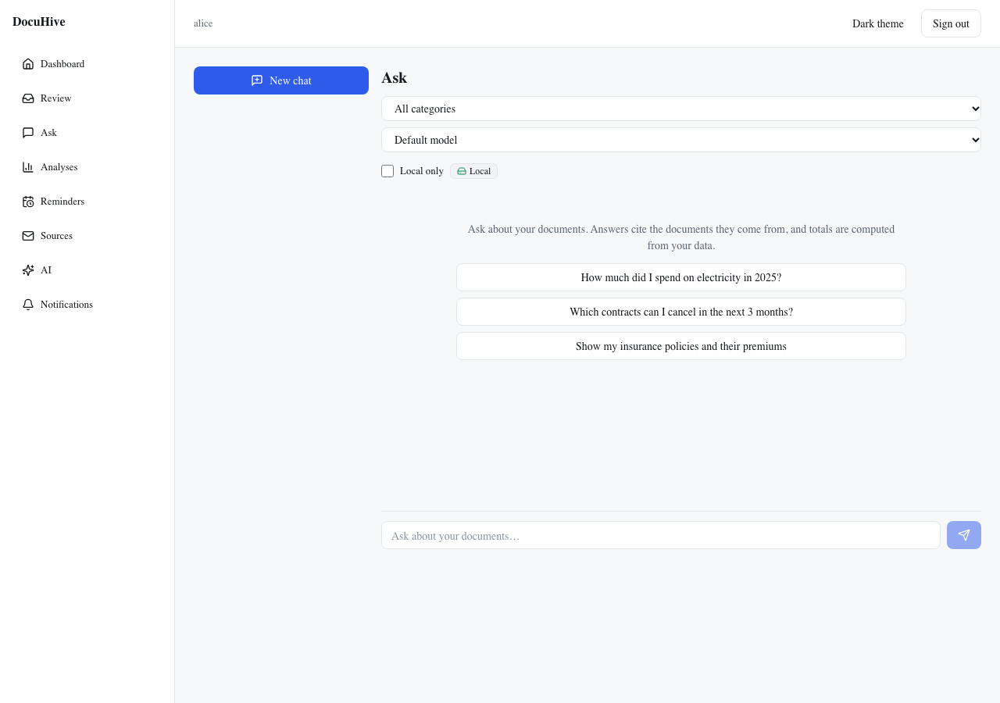
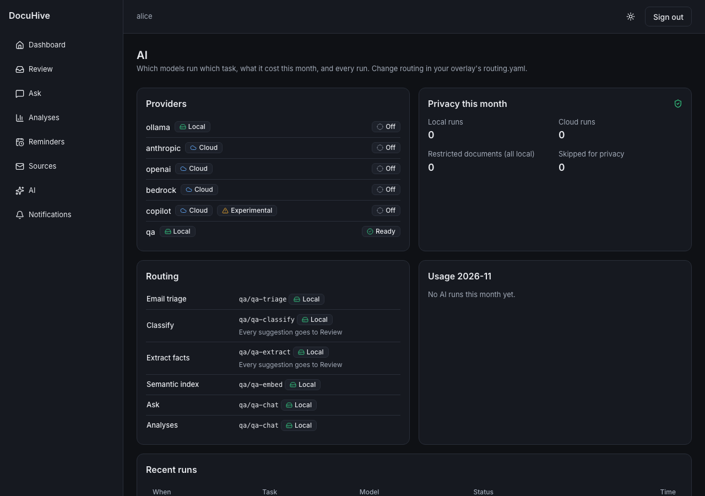

<a href="https://mr-d.dev"></a>

# ⬡ DocuHive

> Point it at your mailboxes, your phone and your scanner, and get one searchable, AI-sorted archive on your own storage, with no folder-and-filename wrangling.

[](https://github.com/d2k-klin/docuhive/actions/workflows/ci.yml)
[](LICENSE)
[](docs/setup/ai-providers.md)
[](#project-status)

## What DocuHive does

Invoices arrive by email, letters come by post, contracts sit in a drawer, and a year later you need the one with the notice period. DocuHive keeps all of them in one archive that you own, and lets you find anything in seconds.

1. **Capture.** It picks up attachments from Gmail, Outlook and other mailboxes (including years of old mail), photos from your phone, files from a scanner folder, and anything you upload.
2. **Read.** Scans and photos are straightened and turned into searchable PDFs. Office files and emails are converted too.
3. **Sort.** An AI assistant files each document into your categories, recognises who sent it, and pulls out the details that matter: amounts, due dates, contract terms, policy numbers. When it isn't sure, it asks you instead of guessing.
4. **Keep.** Originals are stored unchanged on your own storage (a NAS or a disk), next to a readable description of each document. The archive stays usable even without DocuHive.
5. **Find and ask.** Search by words or by meaning, or just ask: *"How much did I spend on electricity in 2025?"* Answers link to the documents they came from, and totals are calculated, not guessed.
6. **Remind.** Due dates, renewal dates and contract notice deadlines become reminders on your phone or in your calendar.

You choose where the AI runs: entirely on your own machine, with a cloud provider, or both. Health and identity documents always stay local.

## A look inside

<picture>
  <source media="(prefers-color-scheme: dark)" srcset="assets/screenshots/ask-dark.png">
  <source media="(prefers-color-scheme: light)" srcset="assets/screenshots/ask-light.png">
  
</picture>

*Ask your archive: suggested questions, category filters and a local-only switch. Real app UI with a synthetic test account; the image follows your light or dark theme.*

<details>
<summary><strong>AI settings</strong>: providers, routing per task, privacy and usage</summary>



*The `qa` provider and the usage figures come from the scripted test environment. More in [assets/screenshots](assets/screenshots/README.md).*

</details>

## What you'll learn

DocuHive is also a worked example of building a real AI product. The code, the [learning notes](docs/learn/README.md) and the app itself show:

- **Agents with [Strands](https://strandsagents.com):** structured output, tools, the agent loop, streaming, several model providers
- **An agent harness:** routing per task, fallbacks, a privacy gate, budgets, and an audit trail of every model call
- **Evals:** golden sets, per-field scoring and a gate before automation is switched on
- **Retrieval:** chunking, embeddings, full-text plus vector search, answers with citations and SQL-computed numbers

Every model call is recorded with its model, prompt version, tools, tokens and cost. The AI settings page shows routing, privacy and usage today; a per-result *How was this made?* view is in progress.

## Quick start

Requirements: Python 3.12 with [uv](https://docs.astral.sh/uv/), Node 22, and Docker.

```bash
git clone https://github.com/d2k-klin/docuhive && cd docuhive
make setup
docker compose -f deploy/compose.dev.yml up -d --wait
make db-upgrade
uv run docuhive user create admin --admin
make dev
```

Open <http://localhost:3000> and sign in with the account you just created. Storage, AI providers, email and notifications are configured with the guides below; a guided setup wizard is planned. For details, see [Development setup](docs/setup/development.md).

## Documentation

| Guide | What's in it |
| --- | --- |
| [Features](docs/FEATURES.md) | Every feature in one sentence, what works today, and ideas for what comes next |
| [AI providers](docs/setup/ai-providers.md) | Local (Ollama) and cloud models, which model does what, privacy and budgets |
| [Email accounts](docs/setup/mail-accounts.md) | Connecting Gmail, Outlook and IMAP; importing old mail |
| [Notifications](docs/setup/notifications.md) | Push and email alerts, reminders, the calendar feed |
| [Development setup](docs/setup/development.md) | Running DocuHive locally and running the checks |
| [Learning path](docs/learn/README.md) | Strands, the agent harness, evals and retrieval, step by step |
| [Requirements](docs/REQUIREMENTS.md) | What DocuHive must do, and why |
| [Architecture](docs/ARCHITECTURE.md) | How it works, from the big picture to each component, user action and hosting option |
| [Implementation plan](docs/IMPLEMENTATION_PLAN.md) | How it is built, milestone by milestone |
| [All documentation](docs/README.md) | Everything else, including decisions and the team plans |

## Project status

DocuHive is in early development and not ready for real documents yet.

| Area | State |
| --- | --- |
| Platform: settings, database, job queue, sign-in | working, tested |
| AI layer, classification, review queue, email connectors, chat | working against test doubles; real-provider runs pending |
| Document intake and archive (OCR, vault) | waiting on the [OCR quality gate](docs/decisions/0001-ocr-gate.md) |
| Web app | pages for review, chat, sources and settings; document pages in progress |

Progress is tracked in the [team plans](docs/shared/README.md).

## Contributing

Read [CONTRIBUTING.md](CONTRIBUTING.md) for the development workflow and checks, and [SECURITY.md](SECURITY.md) for reporting vulnerabilities privately. The [project skills](.agents/skills/README.md) describe the conventions that humans and coding agents follow.

## License

Code: [Apache-2.0](LICENSE). Third-party tools and their licences are listed in [THIRD_PARTY.md](THIRD_PARTY.md). The Mr.D name and artwork are not covered by the code licence ([assets/brand/LICENSE.md](assets/brand/LICENSE.md)); forks keep the code and replace them.

---

Created by **[Mr. D](https://mr-d.dev)**. DocuHive is part of the Hive family, alongside [ReelHive](https://github.com/d2k-klin/reelhive), [SentryHive](https://github.com/d2k-klin/sentryhive) and [CostHive](https://github.com/d2k-klin/costhive).
