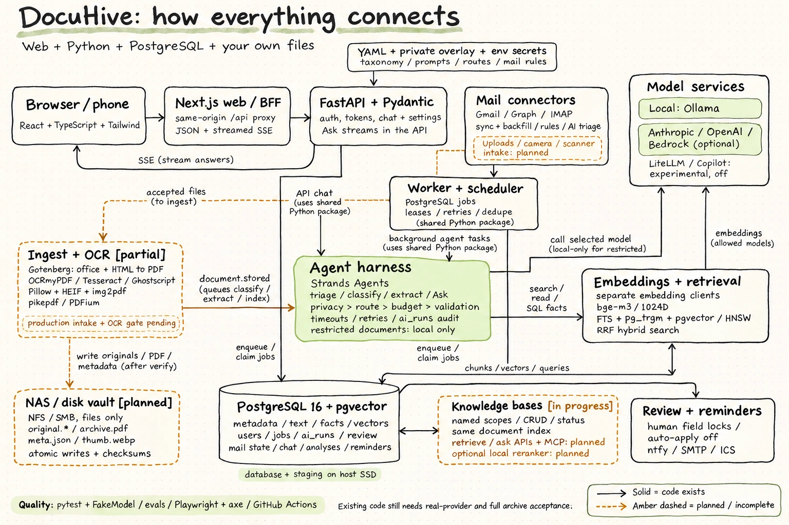

# DocuHive architecture

This document explains how DocuHive works. It starts with the basics, then goes one level deeper in each section, so you can stop reading at the depth you need:

- **Sections 1–3** are for anyone: what DocuHive is, its parts, and what happens when you use it.
- **Sections 4–6** are for people running or changing it: each component, the libraries it uses, and how data flows.
- **Sections 7–10** cover hosting, security, quality, and what exists today versus what is planned.

Related documents: [requirements](REQUIREMENTS.md) (what DocuHive must do, with IDs), [implementation plan](IMPLEMENTATION_PLAN.md) (how it is built, in milestones), [decisions](decisions/README.md) (why), and [contracts](shared/contracts.md) (the exact interfaces between modules).

---

## 1. DocuHive in one minute

DocuHive collects your documents from email, your phone, a scanner and uploads. It turns every one into a searchable PDF, lets an AI assistant suggest how to file it, stores the original permanently on your own storage, and lets you search and ask questions across everything.

Three ideas shape everything else:

1. **Your storage holds the document archive.** Each document is intended to live in its own folder on your NAS or disk, with the original file and a readable description next to it. Document records can then be rebuilt from those folders. Accounts, mail state and chat history still need a database backup.
2. **AI suggests, you decide.** The assistant proposes titles, categories and facts. When it is unsure, it asks you, and it never overwrites something you changed.
3. **You choose where the AI runs.** A local model on your own machine, a cloud provider, or both. Health and identity documents only ever go to a local model.

---

## 2. The big picture

[](../assets/docuhive-architecture-handwritten.webp)

*Open the image for full size. Solid outlines mean code exists; amber dashed outlines mean
planned or incomplete work. Real-provider, NAS and full archive acceptance remain pending.
The handwritten overview is for this guide; the technical blog uses the separate system map.*

```
   You (browser or phone)
          │
          ▼
 ┌──────────────────┐   every request goes through   ┌────────────────────────────┐
 │  Web app         │ ─────────────────────────────► │  API (FastAPI)             │
 │  Next.js         │   /api/*  (same origin)        │  sign-in, documents,       │
 └──────────────────┘                                 │  search, chat, settings    │
                                                      └──────────┬─────────────────┘
                                                                 │ writes jobs
   Gmail · Outlook · IMAP ──► ┌──────────────────────────────────▼─────────────────┐
   phone · scanner folder ──► │  Worker                                           │
                              │  ingest → OCR → store → classify → extract → embed│
                              │  mail sync · reminders · notifications            │
                              └──────┬────────────────┬────────────────┬──────────┘
                                     │                │                │
                         ┌───────────▼─────┐  ┌───────▼────────┐  ┌────▼───────────────┐
                         │ PostgreSQL      │  │ Vault (NAS)    │  │ AI models          │
                         │ index, search,  │  │ originals,     │  │ Ollama (local) or  │
                         │ vectors, jobs,  │  │ searchable     │  │ Anthropic, OpenAI, │
                         │ audit           │  │ PDFs, meta.json│  │ Bedrock            │
                         └─────────────────┘  └────────────────┘  └────────────────────┘
```

| Part | What it does | Runs as |
| --- | --- | --- |
| **Web app** | The screens you use: dashboard, review, ask, analyses, reminders, sources, AI and notification settings | a Next.js server (`apps/web`) |
| **API** | Signs you in, checks permissions, answers the web app, streams chat answers | `docuhive api` (FastAPI + uvicorn) |
| **Worker** | Background OCR, document AI, indexing, mail sync and reminders; interactive chat runs in the API | `docuhive worker` (one or more processes) |
| **PostgreSQL** | Metadata, full-text and vector search, the job queue, the AI audit trail | a database container (`pgvector/pgvector:pg16`) |
| **Vault** | The permanent archive: one folder per document | a folder on the NAS or a disk |
| **Gotenberg** | Converts office files, emails and HTML to PDF | a container |
| **AI models** | Read and sort documents, embed text, answer questions | Ollama on the host, or a cloud API |

The API and the worker are **the same Python package** (`services/docuhive`) started with different commands. They share code, configuration and the database. There is no message broker: the job queue is a table in PostgreSQL.

---

## 3. What a user does, and what happens behind it

Each row is a user action, the screen where it happens, and what the system does. **Status** says whether it works today; see §10 for the full picture.

| You… | Where | Behind the scenes | Status |
| --- | --- | --- | --- |
| Sign in | `/login` | Password checked with Argon2; a `dh_session` cookie is set; every later change needs the `X-DocuHive-CSRF` header | works |
| Switch light/dark theme | header icon | Stored in the browser; the class on `<html>` switches colour tokens | works |
| Connect a mailbox | `/sources` | OAuth for Gmail or Microsoft, or IMAP credentials; tokens encrypted with `DOCUHIVE_MAIL_TOKEN_KEY`; `mail.sync.all` syncs every 15 minutes | works (connectors) |
| Import years of old mail | `/sources` → backfill | `mail.backfill.page` jobs page through the date range and resume after a crash | works (connectors) |
| Upload a file, photograph a letter, drop a scan in a folder | upload, phone capture, scanner folder | All go to `ingest.submit`: detect type → convert → OCR → write the vault → index | works via the API, phone capture and scanner folder; upload page pending |
| Review AI suggestions | `/review` | Each field the AI was unsure about shows the suggestion and its confidence; accept or reject per field or per document | works |
| Correct a title or category | document page / review | `documents.apply_metadata` writes the database and `meta.json`, and locks the field so AI never overwrites it | API and review edits work; document page pending |
| Search | search box | Full-text (German/English stemming, accents, typos) and meaning-based search, fused into one ranking; only documents you may see | search engine works; search page pending |
| Ask a question | `/ask` | The Ask agent searches, reads documents, computes Decimal totals from SQL facts, and streams an answer with citations | works against test doubles; real archive integration pending |
| Save and re-run an analysis | `/analyses` | A saved prompt + filters + model, re-run as an `analyses.run` job | works |
| See reminders | `/reminders`, calendar | Due dates and notice periods from extracted facts; a hourly scan; an `.ics` calendar feed | works |
| Get notified | `/settings/notifications` | Channels: ntfy push or email; daily review-backlog and backup checks | works |
| Choose AI models and privacy | `/settings/ai` | Shows `routing.yaml`: which model runs which task, providers, privacy counts, monthly usage and every run | works |
| See how an AI result was made | `/settings/ai/runs/{id}` | The run's model, prompt version, tools, tokens, cost and output, from `ai_runs` | works |
| Create an API token | `/settings/tokens` | Scoped, revocable tokens, including knowledge-base permissions and an explicit local-consumer flag | works |
| Manage knowledge bases | `/knowledge` | Save filters, share a scope, inspect indexing status and edit or delete your own scopes | works; archive ingest remains gated |
| Use a knowledge base from another agent | API / MCP | Retrieve and ask over a named scope, with permissions and privacy | planned ([plan](shared/knowledge-bases.md)) |

---

## 4. Design principles

These rules decide most trade-offs in the code.

1. **The vault preserves documents and metadata.** Metadata changes are intended to reach both the database and the document's `meta.json`. A planned vault rebuild restores document records; re-embedding restores vectors. Accounts, mail state and chat history require a database backup.
2. **One database does the platform work.** Jobs, full-text search, fuzzy matching, vectors and the audit trail all live in PostgreSQL. This means one backup, and "document saved" and "job queued" happen in one transaction. ([Why not a vector database or a search engine?](decisions/0002-knowledge-bases.md))
3. **Background work uses the worker.** OCR, conversion, document AI and saved analyses use jobs. Interactive Ask runs through the shared harness in the API process and streams its response.
4. **The web app holds no business logic.** It is a "backend for frontend": every `/api/*` request is proxied to the Python API on the same origin, so the browser never talks to the API directly.
5. **One permission rule.** `auth.visible_docs(user)` is a single SQL condition used by every query: lists, search, vectors and agent tools.
6. **Agents use one harness.** LLM tasks share routing, privacy, budgets, validation and logging (§5.8). Embeddings use separate provider clients with route selection, document privacy checks and audit logging (§5.7).
7. **Check privacy before sending content.** Routing and tool masking exclude restricted text from cloud calls. The `ai_runs` constraint `CHECK (NOT restricted OR local)` additionally catches inconsistent audit records; a log written after an attempt cannot prevent that request.
8. **The public code works on its own; personal settings live in a private overlay.** Taxonomy, prompts, routing and evaluation data can be overridden from a separate, private folder (§5.11).

---

## 5. Components in depth

### 5.1 Web app (`apps/web`)

| Concern | Choice |
| --- | --- |
| Framework | **Next.js 16** (App Router) with **React 19** and **TypeScript 7** |
| Styling | **Tailwind CSS 3** with design tokens as CSS variables (colours, control heights, radii); light and dark themes via a class on `<html>` |
| Components | shadcn/ui-style components in `components/ui` (Button, Input, …) built on `@radix-ui/react-slot`; icons from `lucide-react` |
| Font | **Inter** (variable), self-hosted from `@fontsource-variable/inter` through `next/font` |
| API client | `openapi-fetch` with types generated from the API's OpenAPI schema by `openapi-typescript` (`make gen-api`) |
| Tests | Vitest (unit), Playwright + axe (browser journeys, accessibility, control heights) |

**Pages today:** dashboard `/`, `/login`, `/review`, `/ask`, `/analyses`, `/reminders`, `/sources`, `/settings/ai`, `/settings/ai/runs/[id]`, `/settings/notifications`, and `/dev/ui` (a control gallery used by the height test). Document pages, search, upload and phone capture are part of the platform track's web milestone.

**The proxy.** `app/api/[...path]/route.ts` forwards every method to `DOCUHIVE_API_URL`, including server-sent events for streamed chat answers. Because the browser only sees one origin, the session cookie stays first-party and there is no CORS configuration.

**UI rules** (enforced by the `docuhive-ui` skill and the browser tests):

- one font
- a small type scale, with page titles ≤ 20 px
- every control 36 px high, or wrapping controls with 36 px as a minimum
- no horizontal scrolling at 375, 768 and 1280 px

### 5.2 API (`docuhive api`)

**FastAPI** on **uvicorn**, with **Pydantic v2** models for every request and response. The routers are grouped by area:

| Prefix | Area |
| --- | --- |
| `/api/auth/*`, `/api/tokens`, `/api/users` | sign-in, sessions, password, API tokens, user admin |
| `/api/system/*` | health, setup status, job queue and retry |
| `/api/review/*` | the review queue: accept or reject per item or document |
| `/api/chat/*`, `/api/analyses/*` | chat sessions and messages (SSE), saved analyses |
| `/api/sources/*` | mail accounts, OAuth start/callback, sync, backfills, mail log, import a message |
| `/api/ai/*` | providers, routing, usage, runs, reclassify, semantic search, similar documents |
| `/api/taxonomy`, `/api/reminders*`, `/api/notifications/*` | vocabulary, reminders and the `.ics` feed, notification channels |

**Authentication** (`docuhive.auth`):

- passwords hashed with **Argon2** (`argon2-cffi`)
- server-side sessions in the `sessions` table, sent as the `dh_session` cookie
- every state-changing request must carry `X-DocuHive-CSRF: 1`
- **API tokens** with scopes, for scripts and other agents
- rate limits on sign-in
- `DOCUHIVE_AUTH_DISABLED=true` is allowed only in development

### 5.3 Worker and job queue (`docuhive worker`, `docuhive.jobs`)

Jobs are rows in the `jobs` table. A worker claims the next due job with `SELECT … FOR UPDATE SKIP LOCKED`, so several workers can share the table without blocking each other:

```python
select(Job).where(Job.status == "pending", Job.queue.in_(queues), Job.run_after <= now)
           .order_by(Job.run_after, Job.id).limit(1).with_for_update(skip_locked=True)
```

- **Queues** keep slow work apart: `ocr`, `ai`, `mail`, `default`. In the QA stack, one worker serves `ai,mail,default` and a separate `worker-ocr` serves `ocr`, so a big mail import cannot starve OCR.
- **Leases and retries:** a claimed job records who holds it. If the worker dies, the job is recovered. Failures retry with exponential back-off, from 30 s up to 1 hour.
- **Scheduler:** periodic jobs run under one elected leader, so they never run twice:

  | Job | Runs |
  | --- | --- |
  | `mail.sync.all` | every 15 minutes (`sync_every_min`) |
  | `jobs.cleanup` | daily |
  | `notify.backup_check` | daily |
  | `notify.review_backlog` | daily |
  | `notify.scan_dead_jobs` | hourly |
  | `reminders.scan` | hourly |

- **Handlers today:**

  | Area | Handlers |
  | --- | --- |
  | AI | `ai.classify`, `ai.extract`, `index.embed`, `analyses.run` |
  | Mail | `mail.sync`, `mail.backfill.page`, `mail.process` |
  | Documents | `document.stored`, `.metadata_changed`, `.trashed`, `.restored`, `.quarantined`, `.purged` |
  | Reminders | `reminders.sync` |

The ceiling of a table queue is around 100k jobs a day, far above a personal archive. The plan names Valkey + RQ as the upgrade if that is ever reached.

### 5.4 Ingest and OCR (`docuhive.ingest`)

The pipeline every document goes through, whatever its source:

1. **Receive** into `staging/` on the local SSD, compute SHA-256, and respond immediately.
2. **Deduplicate** on `(owner, sha256)`.
3. **Detect** the real type from the bytes (`filetype`), never the file name, and reject unsafe content (`ingest.safety` runs parsers in an isolated process with time limits).
4. **Convert:**
   - images → PDF with `img2pdf`, with HEIC via `pillow-heif`
   - office files, `.eml` and HTML → PDF with **Gotenberg**
   - encrypted PDFs → checked with `pikepdf`, quarantined if they can't be opened
5. **OCR** with **OCRmyPDF** + **Tesseract** (`deu+eng`): PDF/A-2 output, `skip_text` (pages with text are kept), rotation and deskew. OCRmyPDF calls **Ghostscript** and **unpaper** as subprocesses. A deskew failure retries without deskew; a PDF/A failure falls back to a plain PDF.
6. **Extract** the text and a page-1 thumbnail with **pypdfium2**.
7. **Write the vault** atomically, verify the checksums, write `meta.json`, then commit the database row.
8. **Emit** `document.stored`, which queues classification, extraction and embedding.

A document problem (encrypted, unsupported, too many pages) sets `status = quarantined` with a reason, and the staged file stays for a retry. A missing service waits instead: an unmounted vault or an unreachable converter defers the job without spending an attempt. Other errors are retried, and quarantined after the last attempt.

Each step runs in its own process with a time limit, and the job renews its lease while OCR runs. Every state change commits in the same transaction as the job or event it implies (`jobs.enqueue(in_session=…)`), so a crash can never store a document without `document.stored`, or quarantine one without telling anyone. `submit` keeps a `request.json` next to the staged files; the hourly `ingest.reconcile` resubmits a folder whose database row never committed.

**Status:** works end to end, tested on PostgreSQL with Gotenberg and Tesseract on synthetic files. The [OCR quality gate](decisions/0001-ocr-gate.md) was waived by the owner; real-document measurements are part of the release gate.

The worker image (`services/docuhive/Dockerfile`) is **Debian trixie**. It ships Ghostscript 10.05, which ocrmypdf needs; bookworm's 10.0.0 is refused. CI runs real OCR inside the image (`make ocr-smoke`).

### 5.5 Storage: the vault

```
vault/
├─ 2026/
│  └─ 01JC9Z4K7R…/            one folder per document; the id is a ULID (time-sortable)
│     ├─ original.pdf         the bytes as received, never changed
│     ├─ archive.pdf          PDF/A with the OCR text layer
│     ├─ thumb.webp           preview
│     └─ meta.json            title, date, category, sender, tags, facts, provenance, AI runs
├─ library/                   generated human-friendly view (safe to delete)
├─ consume/                   scanner drop folder
└─ _system/                   database dumps, VAULT_ID, format version
```

- **Atomic writes:** a temporary file, `fsync`, then a rename in the same folder.
- **Vault health:** before any write, the worker checks `_system/VAULT_ID` against the database, on every check (only the write probe is cached for 30 s). If the NAS is unmounted, vault writes pause, uploads wait in `staging/`, and the UI shows a banner.
- **`docuhive vault init`** creates a vault only in an empty folder, and refuses to move a database to a different vault: an empty mount point for an absent NAS never becomes a replacement.
- **`meta.json`** is rendered from the database after every change, with the document row locked from render to rename, and a re-render job is committed with the change itself.
- **Without DocuHive:** the archive is still a tidy set of folders with PDFs and readable JSON.

**Recovery boundary:** vault writes and rebuild remain planned. Rebuild is intended to restore
documents and their metadata, not users, sessions, mail cursors or chat history. Keep a
PostgreSQL backup as well as the file archive.

### 5.6 Database (PostgreSQL 16)

**Extensions:**

| Extension | Used for |
| --- | --- |
| `pgvector` | embeddings, with an HNSW index |
| `pg_trgm` | typo-tolerant matching on titles and senders |
| `unaccent` | "Muller" finds "Müller" |

There are three text-search configurations, `dh_german`, `dh_english` and `dh_simple`, each with accents stripped.

**Two migration environments** (Alembic), so the platform and intelligence tracks can change their own tables independently:

| Environment | Owns |
| --- | --- |
| **core** | users, sessions, API tokens, documents, tags, correspondents, facts, sources, notes, audit log, jobs, settings |
| **intel** | `ai_runs`, review items, mail accounts and messages, `doc_chunks` (embeddings), chat sessions, analyses, reminders, notification channels |

Key columns:

- `documents`: ULID `id`, `owner_id`, `shared`, `status`, `sha256`, `title`, `document_date`, `language`, `fts_config`, `category`, `document_type`, `content`, `content_tsv`, `manual_fields[]`, `deleted_at`
- `doc_facts`: typed extracted values (`value_num`, `value_date`, `value_text`, `currency`), read through SQL for Decimal totals per currency
- `doc_chunks`: `document_id`, `chunk_no`, `text`, `embedding vector(1024)`, `embed_model`
- `ai_runs`: task, provider, model, prompt version, tokens, cost, latency, output, `restricted`, `local`, plus the privacy CHECK

Access goes through **SQLAlchemy 2** with **psycopg 3**. Database models are typed with SQLAlchemy's `Mapped[...]`.

### 5.7 Search and retrieval (`docuhive.search`, `docuhive.index`)

| Layer | How |
| --- | --- |
| **Full-text** | `websearch_to_tsquery` in all three configurations, ORed, so a German or English stem matches either way. Documents are ranked with `ts_rank_cd`, with the title weighted highest, and snippets come from `ts_headline`. When there are fewer than 5 hits, a trigram fallback on titles and senders catches typos. |
| **Semantic** | The query is embedded (`bge-m3`, 1024 dimensions) and compared by cosine distance over `doc_chunks` through the HNSW index. Documents are split into ~800-token chunks with overlap, each starting with a header (title, type, category, sender, date) so the vector carries context. |
| **Hybrid** | **Reciprocal rank fusion**: `score = Σ 1 / (60 + rank)` over both lists (top 50 each). It uses ranks only, so full-text and cosine scores never need to be compared. |
| **Chunk retrieval** | `search.retrieve` fuses full-text and vectors at chunk level, with at most 3 chunks per document. This is the base for Bedrock-style knowledge bases. |

Both sides apply the same permission rule and the same filter builder (`search.filters`): categories, document types, senders, tags, dates, sources and document IDs.

**Embedding requests are separate from Strands.** The [embedding clients](../services/docuhive/src/docuhive/ai/embeddings.py)
call Ollama, OpenAI-compatible or Bedrock APIs directly. Indexing checks document privacy
before sending text and logs attempts to `ai_runs`; indexing and query embedding share one
vector space. These clients do not automatically inherit the LLM harness's budget check or
structured-output retries.

**Knowledge bases are saved scopes over this index.** The current implementation adds
named scopes, CRUD, suggestions and indexing status under `/api/kb`, with ownership,
sharing and local-only settings, plus a tested management page at `/knowledge`. The
manager and token settings are implemented. Retrieve/Ask HTTP endpoints, MCP tools and optional local
reranking remain planned. See the
[KB plan](shared/knowledge-bases.md); no separate vector database or KB service is required.

### 5.8 AI layer (`docuhive.ai`, `docuhive.agents`)

**Library:** [Strands Agents](https://strandsagents.com), with the Ollama, Anthropic, OpenAI and LiteLLM extras, and Bedrock through boto3.

**Providers** (from `config/defaults/routing.yaml`; all off until configured):

| Provider | Kind | Notes |
| --- | --- | --- |
| Ollama | local | the default for classification, extraction and embeddings |
| Anthropic | cloud | default for chat and analyses, with a local fallback |
| OpenAI / compatible | cloud, or local for a LAN server | also LM Studio and vLLM via `base_url` |
| Amazon Bedrock | cloud | natural choice when hosted on AWS |
| GitHub Copilot (via LiteLLM) | cloud | experimental, off by default |

**Routing per task:**

| Task | Default model |
| --- | --- |
| `triage` (mail) | small local |
| `classify`, `extract` | 8B local |
| `embed` | `bge-m3` |
| `chat`, `analyse` | cloud, with a local fallback |

Each task can set thresholds, context limits and fallbacks. Budgets are set in USD per provider per month.

**The harness** (`agents/base.py`): structured LLM tasks take this path; tool-using Ask runs share routing, privacy, budgets, timeouts and audit logging.

```
privacy gate → routes (primary, fallbacks) → budget check → Strands call with timeout
  → domain validation (one retry with the error text) → one ai_runs row per attempt
```

- **Privacy gate:**
  - restricted categories (health, identity) and tags (`private`) may only use local providers
  - unclassified documents are classified locally first, because their sensitivity is unknown
  - the database CHECK constraint backs this up
- **Structured output:** classification and extraction return Pydantic models. Domain validators then check:
  - taxonomy labels exist
  - amounts are positive, with ISO 4217 currencies
  - dates fall in a plausible range
  - IBANs pass their checksum
- **Prompts** are versioned files in `config/defaults/prompts/` (`triage`, `classify`, `extract`, `ask`), and the version is stored with every run.
- **Agents:**
  - `triage` (is this email worth archiving?)
  - `classify`
  - `extract`
  - `ask`, a tool-using agent with `search_documents`, `read_document`, `query_facts` and `list_vocabulary`. Its scope (category, dates, local only) is fixed when its tools are built, so the model cannot widen it. Restricted documents are masked when the route is a cloud model.
- **Suggestions and review:** each result has per-field confidence. Automatic apply is **off** until evaluations pass for that task; until then everything goes to the review queue. Fields a user changed are locked.
- **Testing:** `ai.fake.FakeModel` implements the Strands model interface with scripted answers, so tests exercise the real harness without a provider or network.

### 5.9 Email connectors (`docuhive.mail`)

- **Providers:**
  - Gmail through its REST API (`httpx`, OAuth)
  - Outlook/Live through Microsoft Graph (OAuth)
  - any IMAP server through the standard library's `imaplib`
- **Flow:**
  1. sync every 15 minutes from the provider's cursor
  2. a ledger of seen messages
  3. a rule-based prefilter (`config/defaults/mail-rules.yaml`), where most mail stops
  4. AI triage on sender, subject, a 2 KB snippet and attachment names only
  5. accepted attachments go to ingest with their provenance
- **Backfill** pages through a date range, stores its page token, and resumes after a restart.

### 5.10 Reminders and notifications (`docuhive.reminders`, `docuhive.notify`)

- **Reminders** come from extracted facts: due dates, renewals and notice deadlines. They are scanned hourly, and can be done, dismissed, or subscribed to as a calendar feed (`/api/reminders.ics`).
- **Notification channels** are **ntfy** push and **email**, with a plugin kind for others. Daily checks report the review backlog and the backup status, and an hourly check reports failed jobs.

### 5.11 Configuration and the private overlay (`docuhive.config`)

- **Environment variables** (prefix `DOCUHIVE_`), documented in `.env.example`:

  | Variable | Sets |
  | --- | --- |
  | `DOCUHIVE_DATABASE_URL` | the database |
  | `DOCUHIVE_VAULT_DIR` | the vault folder |
  | `DOCUHIVE_STAGING_DIR` | where uploads wait |
  | `DOCUHIVE_SECRET_KEY` | core secret required in production |
  | `DOCUHIVE_MAIL_TOKEN_KEY` | Fernet encryption of mail credentials |
  | `DOCUHIVE_PUBLIC_URL` | the public address |
  | `DOCUHIVE_API_URL` | the API address, for the web proxy |
  | `DOCUHIVE_GOTENBERG_URL` | the converter |
  | `DOCUHIVE_OCR_LANGUAGES` | OCR languages |
  | `DOCUHIVE_OCR_JOBS` | OCR parallelism |
  | `DOCUHIVE_MAX_UPLOAD_MB` | the upload size limit |
  | `DOCUHIVE_AI_*` | provider keys and AI settings |

  Settings are validated with `pydantic-settings`.
- **Defaults** in `config/defaults/`: `routing.yaml`, `taxonomy.yaml` (categories, document types, fact schemas, languages, restricted categories), `mail-rules.yaml`, `analyses.yaml` and `prompts/`.
- **Private overlay:** `DOCUHIVE_OVERLAY_DIR` points to a separate private folder or repo. Its files override the defaults: mappings merge, and lists and scalars replace. It is the place for your own taxonomy, prompts, routing, plugins and the golden evaluation set built from real documents. It is never committed to the public repository.

---

## 6. Deep dives: three journeys end to end

### 6.1 A letter, from photo to answer

```
phone photo ─► ingest.submit ─► staging/ + SHA-256 ─► dedupe ─► detect (bytes)
   ─► img2pdf ─► OCRmyPDF/Tesseract (PDF/A, deu+eng) ─► pypdfium2 text + thumbnail
   ─► vault/2026/<ULID>/{original, archive.pdf, thumb.webp, meta.json} ─► documents row
   ─► job document.stored
        ├─► ai.classify  (local model; title, category, type, sender, date, tags + confidence)
        ├─► ai.extract   (per-type fact schema: amount, due date, policy number …)
        ├─► index.embed  (chunks + bge-m3 vectors → doc_chunks)
        └─► reminders.sync (a due date becomes a reminder)
   unsure fields ─► review queue ─► you accept or correct ─► DB + meta.json, field locked
```

### 6.2 A question in chat

1. You ask in `/ask`: "How much did I spend on electricity last year?", optionally scoped to a category or to local models only.
2. The API creates a chat message and starts the Ask agent through the harness. The privacy gate picks the route.
3. The agent calls `search_documents` (hybrid search, permission-filtered), then `read_document` for the best hits.
4. For the total it calls `query_facts`, which reads scoped `doc_facts` through SQL and computes Decimal totals per currency, returning the rows it used.
5. The answer streams back over SSE through the web proxy. Citations render as links to the documents, and the run appears under AI settings.

### 6.3 One model call through the harness

1. Feature code asks for task `classify` on document *D*.
2. The privacy gate checks *D*'s category and tags. If restricted (or still unclassified), only local routes remain.
3. The router walks the primary route, then the fallbacks, skipping disabled providers and those over their monthly budget.
4. A Strands `Agent` runs with a timeout and returns a Pydantic object.
5. Domain validation runs. On an error, it retries once with the error text in the prompt.
6. An `ai_runs` row records task, provider, model, prompt version, tokens, cost, latency and output, plus `restricted`/`local` flags that the database checks.

---

## 7. Hosting

All options run the same containers and the same code; what changes is where they run and where the AI lives.

### 7.1 At home on an always-on machine (recommended)

```
 ┌────────────── Mac mini (32 GB) or Linux mini PC ───────────────┐        ┌──── NAS ────┐
 │  Ollama (native, uses the GPU)   ◄── AI calls ──┐               │        │ WD My Cloud │
 │  Docker (OrbStack on macOS):                     │               │  NFS/  │ vault/      │
 │    postgres (pgvector) · gotenberg · api ·       │               │  SMB   │ consume/    │
 │    worker · worker-ocr · web ────────────────────┘               │◄──────►│ _system/    │
 │  SSD: database, staging/                                        │        └─────────────┘
 │  Tailscale: private HTTPS for phone and laptop (`tailscale serve`)
 └─────────────────────────────────────────────────────────────────┘
```

- **Machine:** 16 GB is enough if cloud AI does the heavy lifting; 32 GB runs local 8B models comfortably. OCR is CPU-bound, so 4+ cores help.
- **Memory on a 32 GB Mac mini:**

  | Process | Memory (approx.) |
  | --- | --- |
  | PostgreSQL, API, worker, web | 2 GB |
  | `bge-m3` embeddings | 1.2 GB |
  | an 8B chat model | 6 GB |
  | **Total** | **≈ 10 GB** |

  That leaves room for macOS and a larger model loaded on demand.
- **Storage:** the database and `staging/` on the local SSD; the vault on the NAS, mounted over NFS (preferred) or SMB. The vault-ID check protects against writing into an unmounted folder.
- **Network:** nothing is exposed to the internet. Services listen on the LAN or Tailscale only, and `tailscale serve` provides HTTPS, which phone camera capture requires.
- **Backups:** a nightly `pg_dump` into `vault/_system/`, plus `restic` of the whole vault to a USB disk and/or S3/B2. A monthly restore drill rebuilds from the vault into an empty database.

### 7.2 Development on a laptop

```bash
make setup                                              # uv sync, npm ci, pre-commit
docker compose -f deploy/compose.dev.yml up -d --wait   # postgres (pgvector) + gotenberg
make db-upgrade
uv run docuhive user create admin --admin
make dev                                                # api, worker and web with reload
```

`deploy/compose.test.yml` is a disposable stack for integration tests. `deploy/compose.e2e.yml` is the full QA stack: api, workers, web, a fake LLM, mock mail and an HTTPS gateway. See [development setup](setup/development.md).

### 7.3 A small cloud VM

The same containers on one VM (Hetzner, Lightsail or EC2, 4 vCPU and 8–16 GB):

- **AI:** a cloud provider (Bedrock, Anthropic, OpenAI) instead of Ollama. Restricted documents get no AI, or a small CPU model.
- **Storage:** the vault on an attached volume, backed up with restic to S3/B2. A home machine pulls a copy of the vault over Tailscale, and because the vault is self-describing, that copy is complete on its own.
- **Access:** Tailscale only (best), or Caddy with TLS and rate limiting if it must be public.

### 7.4 AWS at scale (only for a hosted, multi-user product)

| Service | Runs |
| --- | --- |
| ECS Fargate | api, workers and web |
| RDS PostgreSQL | the database, with pgvector |
| EFS | the vault |
| Bedrock | the models |
| ALB | load balancing |

It costs more and has more moving parts. It is not needed for personal use.

**Status:** the development, test and QA compose files exist. A production compose file with the backup timer is part of the platform's operations milestone.

---

## 8. Security and privacy

- **Accounts:**
  - Argon2 password hashes
  - server-side sessions with expiry
  - a CSRF header on every change
  - sign-in rate limits
  - scoped API tokens
  - admins have the same document rules as everyone else (admin means operations, not data access)
- **Permissions:** one SQL rule, `visible_docs(user)`: your documents plus shared ones, never trashed ones. Every list, search, vector query and agent tool uses it.
- **AI privacy:**
  - restricted documents reach local models only; the database refuses to record anything else
  - unclassified documents are classified locally first
  - the Ask agent masks restricted documents when it runs on a cloud model
- **Secrets:**
  - mail tokens are encrypted with Fernet (`cryptography`), keyed by `DOCUHIVE_MAIL_TOKEN_KEY`
  - API keys come from environment variables, never from config files
  - gitleaks runs in pre-commit and CI
- **Network:** designed for LAN and Tailscale. The browser talks to one origin.
- **Untrusted files:** types are detected from bytes; parsers run isolated with limits; active and remote content is stripped from email HTML.
- **Public repository:** synthetic test data only; personal data, prompts and the golden evaluation set live in the private overlay.

---

## 9. Quality: how changes are checked

| Layer | What runs | Where |
| --- | --- | --- |
| Unit | `pytest` with fakes (no keys, no network; a socket guard fails any network call), coverage ≥ 85% | CI `python` |
| Types and lint | ruff, mypy, ESLint, `tsc` | CI `python`, `web` |
| Contracts | the documented interfaces in `shared/contracts.md` are compared with the code | CI `python` |
| Integration | real PostgreSQL and Gotenberg (`compose.test.yml`): search, pgvector, privacy constraint, jobs | CI `integration` |
| OCR | real OCR inside the worker image | CI `OCR in the worker image` |
| Web | lint, typecheck, unit tests, production build, licence check, `npm audit` | CI `web` |
| Browser | Playwright journeys, axe accessibility, control heights, overflow, fonts, at 375/768/1280 px in light and dark | QA stack (`make qa-e2e`), nightly |
| AI quality | evaluations per field against a synthetic set (public) and a golden set (overlay); automation switches on only after passing | `docuhive eval` |
| Secrets and dependencies | gitleaks, pip-audit, Dependabot (uv, npm, actions) | CI `secrets`, `python` |

---

## 10. What exists today

| Area | State |
| --- | --- |
| Platform: settings, overlay, database, migrations, job queue, worker, scheduler | works, tested |
| Sign-in, sessions, tokens, permissions | works, tested |
| AI layer: providers, routing, harness, privacy gate, budgets, `ai_runs`, run pages | works against test doubles; real-provider runs pending |
| Classification, extraction, review queue | works against test doubles |
| Email connectors, triage, backfill | works against recorded and mock providers |
| Chat, analyses, reminders, notifications | works against test doubles |
| Full-text, semantic and hybrid search; chunk retrieval | works, tested on PostgreSQL |
| OCR, conversion, text and thumbnails | modules work; real OCR checked in the image |
| Document intake into the vault (`ingest.submit`), the documents API and the scanner folder | works, tested on PostgreSQL with real OCR; synthetic files only |
| Phone capture page | works |
| Document, search and upload pages | pending |
| Production compose and backups | in progress: `deploy/compose.yml`, backup and upgrade scripts and a backup timer exist; drills on the target hardware pending |
| Knowledge-base scopes, CRUD, suggestions, indexing status and `/knowledge` management UI | implemented and verified against the real API; archive ingest remains gated |
| Knowledge-base retrieve/Ask HTTP APIs, MCP server and optional reranker | planned ([plan](shared/knowledge-bases.md)) |

---

## Appendix A. Libraries

**Python** (`services/docuhive`, Python 3.12, managed with `uv`):

| Library | Used for | Licence |
| --- | --- | --- |
| FastAPI, uvicorn | the API and its server | MIT, BSD |
| Pydantic v2, pydantic-settings | models, validation, settings | MIT |
| SQLAlchemy 2, Alembic, psycopg 3 | database access and migrations | MIT, LGPL |
| pgvector (Python) | vector columns | MIT |
| httpx | Gmail, Graph and other HTTP calls | BSD |
| argon2-cffi, cryptography | password hashing, token encryption | MIT, Apache/BSD |
| python-ulid | sortable document IDs | MIT |
| PyYAML | configuration files | MIT |
| strands-agents (+ ollama, anthropic, openai, litellm) | agents, tools, structured output, providers | Apache-2.0 |
| OCRmyPDF | OCR into PDF/A (calls Tesseract, Ghostscript, unpaper) | MPL-2.0 |
| pypdfium2, pikepdf, img2pdf | PDF text and thumbnails, encryption checks, image to PDF | Apache/BSD, MPL-2.0, LGPL |
| Pillow, pillow-heif, filetype | images, HEIC, type detection | MIT-CMU, BSD, MIT |

AGPL and GPL tools (Ghostscript, unpaper) are only run as separate processes. PyMuPDF (AGPL) is deliberately not used. Licences are checked in CI.

**Web** (`apps/web`, Node 22):

| Library | Used for |
| --- | --- |
| Next.js 16, React 19, TypeScript 7 | the app and server |
| Tailwind CSS 3, PostCSS, Autoprefixer | styling with design tokens |
| @radix-ui/react-slot, lucide-react | component composition, icons |
| @fontsource-variable/inter | the self-hosted font |
| openapi-fetch, openapi-typescript | the typed API client |
| Vitest, Playwright, @axe-core/playwright | unit, browser and accessibility tests |

**Services:**

| Service | Used for |
| --- | --- |
| PostgreSQL 16 + pgvector | the database |
| Gotenberg 8 | office, email and HTML to PDF |
| Ollama | local models |
| Tesseract, Ghostscript, unpaper | OCR tooling inside the worker image |
| Docker Compose, Tailscale, restic | running, private access, backups |

## Appendix B. Glossary

| Term | Meaning |
| --- | --- |
| **Vault** | The permanent folder archive: one folder per document with the original, a searchable PDF and `meta.json` |
| **OCR** | Optical character recognition: reading the text in a scan or photo so it can be searched |
| **PDF/A** | An archival PDF format meant to stay readable for decades |
| **Embedding** | A list of numbers that represents a text's meaning; similar texts get similar numbers |
| **Chunk** | A piece of a document (~800 tokens) that is embedded and retrieved on its own |
| **Hybrid search / RRF** | Combining keyword and meaning-based results by their ranks |
| **Harness** | The code around LLM agent tasks: routing, privacy, budgets, validation and logging; embeddings use separate provider clients |
| **Overlay** | A private folder whose settings override the public defaults |
| **Restricted document** | One in a restricted category (health, identity) or with a restricted tag; local models only |
| **ULID** | A unique ID that also sorts by creation time |
