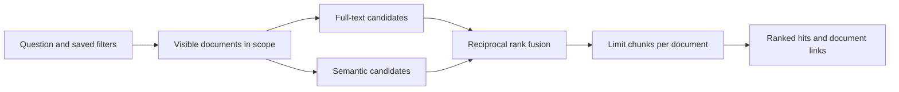

# Hybrid search and saved knowledge bases

**In one sentence.** Combine word matches and meaning matches by rank, then apply
the same saved scope and document permissions to both.

**Why DocuHive needs it.** An invoice number needs an exact match; a question like
“What do I pay for electricity?” may use different words from the bill.

## How it works

PostgreSQL stems German and English words and removes accents. Its full-text
ranking uses word positions; a typo fallback compares titles and correspondents
using trigrams. Chunk candidates are capped before the top-50 cutoff, so a long
document cannot crowd out all other word matches. The semantic function supplies
its own top 50 candidates and applies the same permission and filter rules.

The scores of those two systems have different meanings. Reciprocal rank fusion
(RRF) uses positions instead: an item at position `r` contributes `1 / (60 + r)`.
Appearing in both lists adds both contributions. Results keep the two source ranks,
so you can see why a hit rose. Retrieval returns at most three chunks per document.
Without a semantic function, hybrid search falls back to words. Explicit semantic
mode instead reports that semantic search is unavailable.

A knowledge base stores filters, not copies of documents or embeddings. Its shared
flag makes the scope visible; it never grants access to documents. Indexing status
counts only documents the current caller can see. “Indexed” counts documents with
chunks. “Stale” counts documents whose chunks use another embedding model; these
can also be indexed. Pending or failed reindexing jobs can also overlap that count.

Document search includes stored documents without chunks. It shares fusion and
filter logic with chunk retrieval while keeping document-level full-text search:
using only chunk retrieval would hide documents when embeddings are disabled.

## In the code

- [Search and RRF](../../services/docuhive/src/docuhive/search/__init__.py)
- [Full-text and typo candidates](../../services/docuhive/src/docuhive/search/fts.py)
- [Shared filters](../../services/docuhive/src/docuhive/search/filters.py)
- [Saved scopes and indexing status](../../services/docuhive/src/docuhive/kb/__init__.py)
- [Public contracts](../shared/contracts.md#27-search--docuhivesearch)

## Run it

Run `make learn EX=09`. Two fixed candidate lists fuse without a database, network
or AI key. The example asserts that the document found by both lists wins.

## See it in the app

Open **Knowledge bases**, create a saved scope, and expand **How was this made?**.
The page shows indexed, pending, failed and stale counts with the configured
embedding model. The retrieval test panel and Ask integration are separate work
in the [knowledge-base plan](../shared/knowledge-bases.md).

## Try it yourself

1. Reverse one candidate list in the example and compare the two ranks.
2. Remove the semantic list and observe the word-only ordering.
3. Create a shared scope as one user and open it as another: private documents
   must not increase the second user's document count.

## Pitfalls we hit

- Capping chunks only after the candidate cutoff lets one long document consume
  the full candidate list. Cap word matches before the cutoff as well.
- A shared knowledge base is a saved query, not a new document permission.
- Chunk FTS currently computes vectors at query time. The planned stored chunk
  vector and GIN index improve speed; they do not change the permission rule.
- Synthetic hashed embeddings prove plumbing, not paraphrase quality. Real-model
  quality and the 20,000-document latency target need their own measurements.

## Further reading

- [PostgreSQL full-text search controls](https://www.postgresql.org/docs/current/textsearch-controls.html)
- [PostgreSQL trigram matching](https://www.postgresql.org/docs/current/pgtrgm.html)
