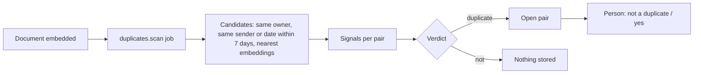

# Near-duplicate detection

**In one sentence.** Compare what two documents say (sender, amount, date and meaning) to
spot the same document arriving twice in different forms, and let a person decide.

**Why DocuHive needs it.** DocuHive collects from mailboxes, phones and a scanner folder, so
the same invoice often arrives as an email PDF and later as a paper scan. Their bytes differ,
so the SHA-256 check at ingest cannot catch them.

## How it works



Each pair gets up to four signals: `same_sender`, `same_amount` (a money fact with the same
value and currency), `close_date` (document dates at most 7 days apart) and
`similar_content` (embedding similarity of at least 0.92).

The rules are deliberately strict, because a false alarm costs more attention than a missed
copy:

- If both dates are known and more than 7 days apart, it is never a duplicate. A monthly bill
  from the same sender, with the same amount and template, is a new period, not a copy.
- Otherwise a pair needs two of `same_sender`, `same_amount` and `similar_content` (all three
  when a date is missing), or near-identical content (similarity of at least 0.97).

Nothing is deleted. A dismissed pair is never suggested again, and a confirmed one is only
recorded; trashing a copy stays the user's choice.

## In the code

- [`duplicates/__init__.py`](../../services/docuhive/src/docuhive/duplicates/__init__.py): signals, the verdict and the scan job
- [`index/jobs.py`](../../services/docuhive/src/docuhive/index/jobs.py): queues the scan after embedding, so similarity is available
- [`api/duplicates.py`](../../services/docuhive/src/docuhive/api/duplicates.py): pairs the user can see both sides of, and decisions
- [`index/semantic.py`](../../services/docuhive/src/docuhive/index/semantic.py): `similar()`, nearest documents by mean chunk vector

## Run it

```bash
make learn EX=13
```

It scores three synthetic pairs with the production rules: a paper scan of the same invoice
(duplicate), next month's invoice (not, despite 0.99 similarity) and a letter from another
sender in the same week (not).

## See it in the app

**Duplicates** in the sidebar lists open pairs with their signals and two buttons.

## Try it yourself

1. Change `CLOSE_DAYS` to 31 and rerun the example: next month's invoice becomes a false alarm.
2. Lower `NEAR_IDENTICAL` to 0.9 and work out which of your own bills would start to match.
3. Add a signal, such as the same invoice number, and decide which rule it should strengthen.

## Pitfalls we hit

- Similarity alone is not enough. Templated documents from one sender (monthly bills,
  payslips) are almost identical in meaning; the date rule is what keeps them apart.
- Run the scan after embedding, not after classification, or the content signal is missing
  for every new document.
- Compare only documents of the same owner. A shared household document should not be
  reported as a copy of someone else's private one.

## Further reading

- [pgvector](https://github.com/pgvector/pgvector): cosine distance and HNSW indexes
